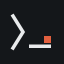

<p align="center">
  
</p>

<h1 align="center">CortexTerm</h1>

<p align="center">
  <strong>A macOS terminal with a local AI model and a security scanner built in.</strong><br/>
  Runs Gemma 4 on your Mac. No account, no cloud, works offline.
</p>

<p align="center">
  <a href="https://github.com/agentbusiness/CortexTerm">github.com/agentbusiness/CortexTerm</a> ·
  <a href="LICENSE.txt">Apache-2.0</a>
</p>

---

## Why CortexTerm

You should be able to ask your terminal "what is using port 3000?" or "why did this build fail?"
without sending your shell history to a cloud service. CortexTerm is a normal terminal (zsh, bash or
fish, your own dotfiles) with a small local model next to it.

- Everything stays on your Mac. There is no account, no API key and no telemetry.
- Every command you run is saved with its folder, exit code, duration and output. You can search
  old runs, filter their logs and ask the model about them.
- The same input line takes shell commands and plain questions.
- If you have more than one Mac, they can share one model between them.
- Every part is a plugin, including the model, the chat and the theme.

## How the AI is kept in check

The model never decides whether a command runs. That is done by ordinary code.

- As you type, a strip under the input line tells you whether it's a shell command or a question,
  which program will run, in which folder, which files a glob matches, and how risky it is.
- A question gets back one suggested command. It goes through the same check as a command you
  typed yourself.
- If the check can prove a command only reads (say `ls`, `df` or `lsof -i`), CortexTerm runs it and
  gives the model the real output to answer from. Anything else waits for you to press Enter.
- Pasted commands and scripts are scanned first. It catches things like `curl ... | sh`, running
  programs from `/tmp`, and removing the quarantine flag from a download.
- Command output is treated as untrusted when the model reads it, so a log line that says "ignore
  your instructions" does nothing.

## Sharing one model between your Macs

A local model takes a lot of memory. Running one in every app on every machine wastes most of it.
CortexTerm can link your machines so they borrow each other's model.

- To pair two machines, type a four-word code on the second one. Each install has its own key, and
  only machines in your signed member list can connect.
- Connections are end-to-end encrypted (QUIC, TLS 1.3). They go direct on your home or office
  network, and through a relay when you're elsewhere. The relay can't read the traffic.
- Each request goes to the best model that is free at that moment, then the model is released
  again. A request you are waiting for goes ahead of background work.
- Apps on the same Mac find each other without pairing. If
  [CortexCode](https://github.com/agentbusiness/CortexCode) is running with its larger coding model,
  CortexTerm uses that and doesn't load Gemma at all. If CortexCode starts later and needs the
  memory, Gemma finishes its current answer and unloads.
- Besides the model, plugins can share specific services. For example CortexCode can ask CortexTerm
  to run a command in its sandbox, and your other Macs can read this one's process traces.
  Other machines can only read; running commands is limited to apps on the same Mac.
- Each shared service has an on/off switch, separately for this Mac and for the network, and every
  call from another machine is logged.

## Security checks

The system plugin looks at your Mac the way a security person would, without asking for your
password. It reports in plain language and suggests fixes as commands. It never runs a fix on its
own.

- **Daily sweep:** FileVault, SIP, Gatekeeper, firewall, sharing, profiles and certificates.
  Outdated apps and runtimes, browser and editor extensions, problems with your SSH keys, and secrets
  left in your shell history or in files.
- **CVE checks:** every three hours it compares recent advisories (NVD, OSV, EPSS, CISA's
  known-exploited list, Apple's release notes) against the versions actually installed. You can
  also ask about a specific CVE.
- **Malware:** a YARA-X scan using Apple's own XProtect rules plus rules for info-stealers. It also
  flags files whose content doesn't match their extension, and programs with the quarantine flag
  removed.
- **Things that start by themselves:** launch agents and daemons, login items, cron jobs, shell
  startup files, SSH authorized keys, git hooks, editor tasks that run when a folder opens.
- **Network:** which process talks to which network and country, checked against threat lists. It
  alerts when an app talks to a paste site, a webhook or a tunnel service.
- **AI coding tools:** it warns when a tool like Claude Code, Codex or Gemini CLI is started with its
  safety prompts turned off by an install script. Malicious npm packages have done exactly this.
- **Privacy:** programs listening to the keyboard, whether the camera or microphone is on right now,
  and which apps hold Full Disk Access and similar permissions.

## Other things it does

**Completion.** Tab completes from your shell's PATH, aliases and functions, plus files, git
branches, SSH hosts and process names. The right arrow accepts a suggestion from your history.

**Desks.** Panes are grouped into Desks, one per job. You work in up to three panes at a time and
the others sit on a shelf as small live cards. ⌘J jumps to whatever needs you, ⌘M shows all Desks,
⌘; finds a pane by name, command or folder.

**Shells survive restarts.** A small background process, `cortexd`, owns the shells. Quitting or
updating the app doesn't kill what's running in them.

**Log view.** Any command's output can be opened as a log. JSON and logfmt are detected, lines get
levels, and there's a timeline and filters. When a command fails, the model can read it and
suggest a fix.

**Processes.** The sidebar shows CPU, memory, GPU, network and disk, and every process with its
ports. You can ask what a process is, chart it over the last 20 minutes, watch the files and
sockets it opens, or record a trace that's kept for a week.

**Passwords and prompts.** When a command asks for a password or a yes/no, CortexTerm notices and
asks you in place. If you choose to remember it, the password goes into the macOS Keychain.

**Editors and top.** `nano` and `vi` open a built-in editor, `top` and `htop` open the process view.
Put `!` in front to get the real program.

**Memory.** It remembers the folders you work in, the commands you use there, your SSH hosts and the
fixes that worked. This stays on your Mac and is never shared.

**Editable prompts.** The prompts and skills the model uses are plain files. You can edit them while
the app runs, and every change can be reverted.

## The model

CortexTerm uses **Gemma 4** on llama.cpp with Metal: the E4B version on Macs with more than 8 GB,
E2B on 8 GB Macs. It uses Gemma's draft head for speculative decoding, which makes it faster
without changing the output.

Small models do badly when you hand them a pile of text and hope. So CortexTerm collects the facts
first (the command, its output, the folder, the processes involved) and asks the model to explain
those.

## Who it is for

- People who use the terminal all day and want AI help without a cloud service.
- Mac users who want to know if anything on their machine looks wrong.
- People who keep a lot of shells, servers and SSH sessions open.
- Anyone with two or more Macs who'd rather run one model than several.

## Requirements

- A Mac with Apple silicon and **8 GB** of unified memory or more.
- Disk space for the model (downloaded on first start).

## Start

CortexTerm is not released yet. Run it from this repository:

```sh
./cortexterm
```

The first start builds the app into `build/` and installs its plugins into `~/.cortexterm`. Later
starts open at once and rebuild beside the running app; a changed plugin is swapped in as soon as it
is packed.

## Background runner

`npx cortexterm runner` keeps terminal execution, metrics, monitoring and updates running without a window or a local chat model. AI can use a model elsewhere in the mesh. macOS uses a login service; Linux uses systemd with startup at boot and persistence after SSH logout. Core updates restart the runner automatically; PTY shells survive.

For development, use `./cortexterm runner`; it stays on this checkout's build. Stop with `runner off` through the same launcher. See [RUNNER.md](RUNNER.md) for setup, update behavior and Linux monitoring capabilities. The new launcher behavior becomes available through npx after release.

## Releasing

Everything is built on a Mac with Apple silicon; Linux builds run in Docker on it. Each plugin is
released on its own, so a change to one plugin builds only that plugin. The frame is a small core:
the frame and its Electron shell. `scripts/release/digest.mjs` says what each part is built from.

| Script | What it releases |
|---|---|
| `scripts/release.sh` | **whatever changed since the last release**, in order: frame, plugins, app, npx (`--plan` says what, `--dry-run` builds without uploading) |
| `scripts/release-plugin.sh <plugin> [version]` | one plugin (`--changed`: every plugin whose source changed) |
| `scripts/release-frame.sh [version]` | the frame and its Electron shell |
| `scripts/release-app.sh [version]` | the full app for new users (`.tar.gz`; `.dmg` with `RELEASE_DMG=yes`), from the released parts |
| `scripts/release-npm.sh [version]` | the `npx cortexterm` launcher |

Without a version each takes the next one after the released one: three numbers, each 0 to 99
(`0.3.99` is followed by `0.4.0`). Every script takes `--dry-run` (build into `artifacts/`, upload
nothing). Configuration: `.env.release`.

## Status

CortexTerm is in early development. Expect fast changes and rough edges.

## License

Apache License 2.0. See [LICENSE.txt](LICENSE.txt).

CortexTerm's memory runs on [IronGraph](https://github.com/agentbusiness/IronGraph). Third-party
components, including the vendored llama.cpp, keep their own licenses.
